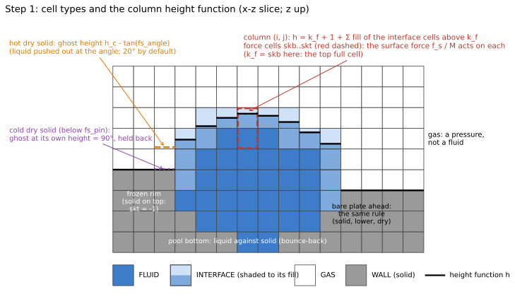
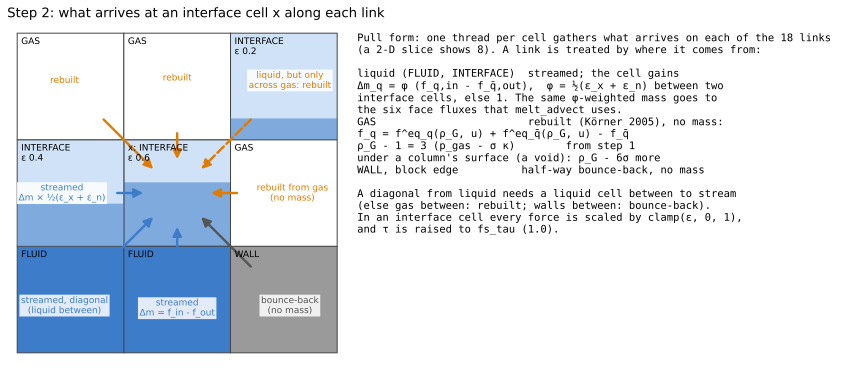
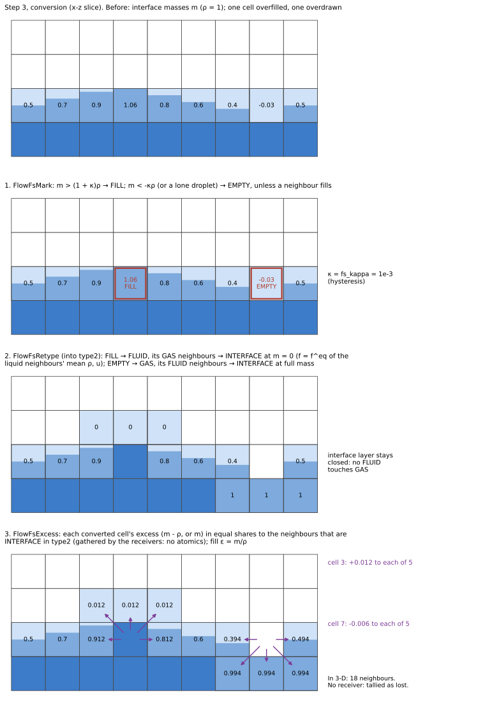
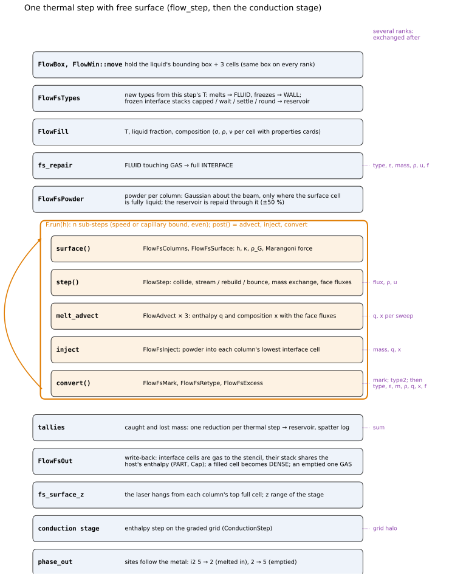
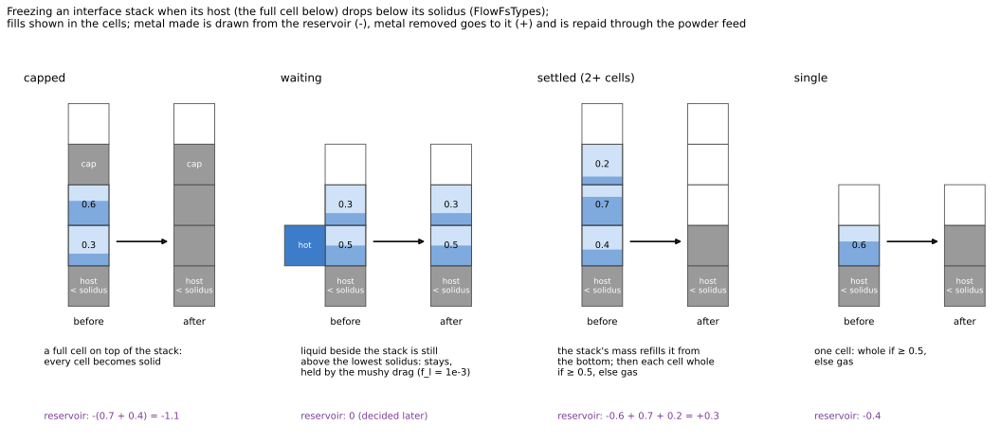

# Free-surface melt-pool flow: theory and implementation

`flow lbm ... free_surface` (2026-11-15 on). This note explains the model
and how the code carries it out. The flow takes three steps per lattice
time step: the **surface**, the **lattice Boltzmann step** and the
**conversion**. Each step has its own section below, giving the theory, the
code, and what it leaves out. The conduction coupling and several-rank
operation come after them.

Code:
- `src/KOKKOS/melt_flow_kokkos.h`: `MeltFlow<R>`, which is standalone and
  free of SPPARKS and MPI. It provides `surface()`, `step()`, `convert()`,
  `inject()` and `melt_advect()`.
- `src/KOKKOS/conduction_solver_kokkos.cpp`: `flow_step()` holds the
  thermal coupling, the powder feed and the write-back. `fs_surface_z()`
  sets where the laser lands.
- `tools/melt_flow_check.cpp`: gates 14-26 cover the free surface (23-26
  the height functions, section 3).
- `docs/figures/make_fs_figures.py`: draws the figures (`python3 docs/figures/make_fs_figures.py`).

Developer notes on the flat-lid flow it extends:
`docs/CONDUCTION_SOURCE.md`, "Melt-pool flow". User syntax:
`doc/temperature_source_conduction.txt`.

## 1. The model in one paragraph

The method is a single-phase free-surface lattice Boltzmann method (Körner
et al. 2005; Thürey 2007). The liquid is resolved and the gas is not: gas
enters only as a pressure on the surface. Every cell is one of four types:

| Type | Holds distributions | Mass | Fill ε |
|---|---|---|---|
| `FLUID` | yes | its density ρ | 1 |
| `INTERFACE` | yes | `cmass`, between 0 and ρ | m / ρ |
| `GAS` | no | 0 | 0 |
| `WALL` (solid metal) | no | — | — |

A closed layer of `INTERFACE` cells always separates `FLUID` from `GAS`.
Mass moves across the links between liquid cells. A cell that fills
becomes `FLUID` and a cell that empties becomes `GAS`, with the interface
layer moved to follow. Surface tension and Marangoni stress come from a
**height function**: local height functions along each interface cell's
normal (section 3), which also see side faces and overhangs. The thermal
solver decides what is liquid or solid, and the flow decides where the
liquid is.

## 2. Units, the sub-step loop and its step size

Inside `MeltFlow` everything is in lattice units (cell = 1, step = 1,
density = 1). `run(h, lo, hi)` advances by one thermal step h in n flow
sub-steps (n even):

```
run(h):                                    per thermal step (flow_step)
  choose n, rescale f if dt changed
  repeat n times:
    1. surface(lo, hi)        FlowFsColumns (2-D), FlowFsHFList, FlowFsHF,
                              FlowFsHFHard, FlowFsHFKappa, FlowFsHFBase
    2. step(lo, hi)           FlowStep                             (3-D)
       post():   melt_advect  FlowAdvect x3 (+ copy)               transport
                 inject       FlowFsInject                         powder
    3.           convert      FlowFsMark, FlowFsRetype, FlowFsExcess
  every 16th call: max |u| (FlowMax), run-away test
```

The caller's `post` hook replaces a bare `convert()`. The carried fields,
specific enthalpy and composition, must move with the step's mass fluxes
before conversion redistributes mass. In `tools/melt_flow_check` there is
no hook and `run` calls `convert()` itself.

**Step size.** n is the larger of two counts:

- **Speed bound.** The fastest cell moves about 0.1 cell per step at
  `u_cap`. `u_cap` starts at `u_ref`, doubles when the measured maximum
  passes 1.5 `u_cap`, and halves below 0.3 `u_cap`.
- **Capillary bound** (fs only):
  $$\Delta t \le c_\sigma \sqrt{\rho\,\Delta x^3/\sigma_{\max}},\qquad c_\sigma = \texttt{fs\_cap} = 0.04,$$
  which keeps lattice σ ≤ c_σ² = 1.6e-3. Without the bound, the shortest
  capillary wave (two cells) travels at about sqrt(πσ), close to the
  lattice speed of sound, and the surface breaks up.
  - Cap values tried: 0.18 grew pits, 0.08 grew a two-cell checkerboard on
    a hot Ti-6Al-4V pool, and 0.04 was calm.
  - σ_max is `sig_rho`: the constant σ, the largest value in the
    properties table, or the largest value in `sigma_table`.

In the 316L DED decks the capillary bound sets n: 26 flow steps per thermal
step. When dt changes, `rescale()` scales f as follows:

- velocity by s;
- pressure deviation by s²;
- non-equilibrium part by s;
- interface mass by the density ratio, so the fill is unchanged.

## 3. Step 1: the surface (`surface()`)

Until 2026-11-18 there were two surfaces: one metal height per (x, y)
column (`fs_curv column`, the default) and the local height functions
below (`fs_curv hf`). The column surface, its `fs_raw` smoothing and the
conversion rule it needed (a9ac6675: liquid enters a gas cell sideways
only over metal) were removed; the keywords went with them. Its formulas
live on in each frame of the height functions.

### Theory

**Height function.** Along an axis d with the gas on side s, a column of
cells has the height of its full cells plus the fill of the partial cells
above them. Over the 3 × 3 columns around a cell that gives a graph
h(x', y') in the other two axes, and

$$\kappa = \nabla\cdot\frac{\nabla h}{\sqrt{1+|\nabla h|^2}}
= \frac{h_{xx}(1+h_y^2) + h_{yy}(1+h_x^2) - 2h_{xy}h_xh_y}{(1+h_x^2+h_y^2)^{3/2}},$$

negative on a liquid hump in any frame (heights grow toward the gas).

**Capillary pressure.** Young–Laplace puts the gas side of the surface at
p_gas − σκ. In LBM pressure is ρ c_s² with c_s² = 1/3, so the gas density
used in step 2's reconstruction is

$$\rho_G - 1 = 3\,(p_\text{gas} - \sigma\kappa)\qquad(\text{lattice units}).$$

`pgas` is a per-column field the caller may set, for example to a recoil
pressure. It is zero today.

**Marangoni stress.** The tangential surface force per unit projected area
is $\sqrt{g}\,\nabla_s\sigma$, with g = 1 + h_x² + h_y². Written in the
tangents (1, 0, h_x) and (0, 1, h_y):

$$\mathbf f_s = \frac{\big[(1+h_y^2)\sigma_x - h_xh_y\sigma_y\big](1,0,h_x) + \big[(1+h_x^2)\sigma_y - h_xh_y\sigma_x\big](0,1,h_y)}{\sqrt{g}}$$

σ_x and σ_y are differences of σ between neighbouring columns. On a flat
surface this reduces to the flat-lid model's force.

### The z-stacks (`FlowFsColumns`)



*Figure 1. An x–z slice of a pool, in the z frame. The black line is h. The orange and purple dashes are the ghost heights a dry, lower rim is given: hot solid uses `fs_angle`, cold solid below `fs_pin` is held at 90° (`fs_pin`, off by default). (Drawn for the removed column surface; in the z frame the rules are the same.)*

A 2-D kernel over the held columns walks down from the window top past
GAS and records, per column, `skt` (the top metal cell; −2 with no metal,
−1 with solid on top or liquid hanging over gas) and `skb` (the FLUID cell
under the interface stack, or the stack's bottom). The powder lands there
(`inject`), the laser hangs from it (`fs_surface_z`), and a void that no
height measures is judged against it (step 4 below).

**Why height functions along the normal.** A DED thin wall is wavy: each
layer's pool bulges out over the neck below and freezes, leaving
re-entrant scallops 50–150 µm deep, 10–30 cells at the 5 µm cells
production will use. One height per z-column cannot describe a surface
whose normal points sideways or down. Such cells got no surface force at
all under the column surface, so a lip of liquid over gas felt only the
ambient pressure and spread freely; a9ac6675 stopped that by forbidding
liquid to enter a gas cell sideways over gas, which also forbade the
overhangs the wall needs. The column surface also ran away on HIP (a 24
m/s spike in a 316L DED track at 0.5 s, not root-caused) where the
height functions ran clean to 1.3 s.

### Method

Popinet 2009 (sections 3–4) and Cummins, Francois & Kothe 2005. Per
INTERFACE cell c, in `surface_hf()` (kernels `FlowFsHFList`, `FlowFsHF`,
`FlowFsHFHard`, `FlowFsHFKappa`, `FlowFsHFBase`; see "Memory and cost"):

1. **Normal and frame.** n = −∇ε by Youngs' 3×3×3 weights (FLUID and WALL
   count as ε = 1, GAS 0, INTERFACE its clamped fill). The frame is the
   axis d of the largest |n_d| and the side s = sign n_d (toward the gas).
   Heights are measured along s·e_d; e1, e2 are the other two axes.
2. **Heights.** Each of the 3×3 columns (u, v) of the frame is walked
   along d from c's row: down to the first full cell m_f, up through
   partial (INTERFACE) cells to the first GAS cell m_e, at most
   L = `HF_L` = 5 cells from c's row. Then h = m_f + ½ + Σε over the
   partial cells, relative to c's centre. A column is
   - *liquid* (it crosses the surface once within reach),
   - *dry* (a full cell right under gas: a dry solid face),
   - *empty* (no full cell in reach: no metal), *high* (no gas in reach),
     *edge* (the block's side or the cells held), or
   - *bad* (gas under a partial cell, or a full cell over one: two
     crossings in reach).

   Walked, not summed over a fixed 3×7 stencil, so a column is accepted
   only if it crosses the surface once. L = 3 (Popinet's 3×7) was tried
   first: a column beside a cell near 45° often needs 4 cells to reach a
   full one, and a sphere of radius 8 cells left 35% of its interface cells
   to the fallbacks; at L = 5, 11%, nearly all holding less than 5% liquid.
3. **Boundary heights**: an empty,
   high or edge column counts as c's own height (a right angle); a dry
   column lower than c's is given max(h_c − tan θ, h_n) with θ =
   `fs_angle`, or its own height (90°) when its cell is colder than
   `fs_pin`. So the contact angle at a dry rim and the pinning act on side
   and under faces as on the top.
4. **Which heights.** The dominant frame is used if c's column is liquid
   and none is bad (empty, high and edge columns are real topology there:
   a wall, the liquid's edge). Else the other two axes in order of |n_d|,
   every column then required to be liquid or dry (a steeper frame
   overflows the reach, so a mirror there would be wrong). Else, in a
   second kernel, the mean curvature of the INTERFACE cells around c
   (3×3×3) that their own heights measured (Basilisk's last resort).
   Else Popinet's fit: a paraboloid z' = c0 + c1x' + c2y' + c3x'² + c4y'²
   + c5x'y' in the normal's frame through the surface points of every
   liquid column of all three frames (6 or more). Else none, and a cell
   under its column's `skb` is held a one-cell bubble's Laplace pressure
   (−6σ in ρ_G − 1, i.e. 2σ/r with r one cell) below the liquid, so a void
   that small closes. At the surface's own pressure it neither closed nor
   grew; bubbles caught in a large 316L pool were stretched and merged
   until a slot opened through the pool and it collapsed (Sattari DED set,
   380 ms, 5b3f30a1).

   *Why the mean before the fit:* the heights are column means, not point
   heights, off the surface by about (h_11 + h_22)/24 cells, more in the
   steeper frames; the fit reads that difference between frames as
   curvature. On a sphere it was 4–6% wrong at radius 8 and 16 alike (it
   does not converge), the mean 1–2%. The cells that need either are
   corner cells holding next to nothing.
5. **Curvature** from the 9 heights by central differences, κ = (h_11(1+h_2²) + h_22(1+h_1²) − 2h_12h_1h_2)/g^{3/2},
   g = 1 + h_1² + h_2², negative on a liquid hump in any frame (heights
   grow toward the gas).
6. **Capillary pressure per cell**: ρ_G − 1 = 3(p_gas(i,j) − σ_c κ_c),
   σ_c from the cell's own T (or `sig`), kept in `hfs(·,0)` and read by
   `FlowStep` for that cell's gas links. p_gas stays per column (a recoil
   pressure comes from the laser above).
7. **Marangoni per frame column**, the formula above in the frame: f = [((1+h_2²)σ_1 − h_1h_2σ_2) t_1 + ((1+h_1²)σ_2 − h_1h_2σ_1) t_2]/√g
   with t_1 = e_1 + h_1 s e_d, t_2 = e_2 + h_2 s e_d, σ of a frame column
   from its top partial (or dry, by T) cell, one-sided beside a column
   without one. It is one acceleration f/M shared
   by the frame column's partial cells and its FLUID base (M their mass,
   at least ½): each INTERFACE cell stores it (`hfs(·,1..3)`) and
   `FlowFsHFBase` lets each FLUID cell gather it from the axis neighbours
   whose frame column it is the base of. Cells measured by the mean or the
   fit carry no Marangoni force (`ponytail:`, a few corner cells).
8. **Conversion.** Liquid may enter any gas cell beside a filled one
   (Körner's rule): a lip over a gap carries the curvature of its tip,
   which pushes it back, and the a9ac6675 rule would forbid the bulges a
   wall needs. Gate 26 tests it: a floating elliptic cylinder (semi-axes 4
   and 10 cells) must round into a circle, its sides growing out over gas.
   It does (half-width −0.5%, Laplace pressure +1.4%); with the a9ac6675
   rule it stalled (half-width −14%, the inside's pressure lost); under
   the column surface it fell apart (half-width +82%).
9. **A solid face's contact angle depends on the frame** (`ponytail:`).
   The boundary rules, carried into each frame, read a vertical
   solid face two ways: in the frame along the face (heights along z, the
   surface meeting the face) the solid column is *high* and mirrors, 90°;
   in the frame across it (heights along x) the solid above or below the
   liquid is *dry and lower*, and `fs_angle` applies: at 20° the liquid
   wets the face and climbs it. Youngs' normal counts WALL as full, which
   tilts the normal of a contact-line cell toward the face's normal, so
   such cells take the second frame. A liquid half-ellipse on a wall
   (semi-axes 4 out, 10 along) stayed a lens pinned 18 cells up the wall at
   20°, and at 0° crept up and down the wall. Below `fs_pin` the face is
   held (90°, its own height), which is how the decks run. The upgrade is
   Basilisk's: a contact angle set through ghost fills in the solid cells,
   one value for every frame.

### Coupling (conduction solver)

| Consumer | |
|---|---|
| Laser (`fs_surface_z`: hangs from each column's top metal cell) | the beam comes from above |
| Powder (`FlowFsPowder`, `inject`, `fs_engulf` pool width) | it falls from above onto the column's top stack, which `FlowFsColumns` finds |
| Freezing (`FlowFsTypes`) and write-back (`FlowFsOut`) | their interface stacks are z-stacks. An underside cell has no host below (gas): it keeps its own T and H and freezes whole when capped. `ponytail:` settling along the cell's frame instead of z if the scallop shapes need it |
| Several ranks | the flow halo is HF_L + 1 = 6 cells deep under `free_surface` (2 for the flat lid), and type, fill, mass, ρ and T (or `sig`) are exchanged that deep: a cell one beyond this rank's (which `FlowFsHFBase` reads) walks its columns 5 more. The f, flux and advection exchanges stay 2 deep |

### Memory and cost

Per held cell: `hfs` (ρ_G, the acceleration, κ: 5 R) and `hfr` (method and
frame, 1 byte) and the two cell lists (`hfl`, `hfh`, 4 B each): 49 B in
double, 29 B in mixed, against about 470 B of flow state per cell (+10%).
The pass works on INTERFACE cells only; at 5 µm a part has 16× the
interface cells of 20 µm but 64× the cells, so it shrinks against
`FlowStep`. The surface is not what costs at 5 µm: the capillary
bound makes the step scale as Δx^{3/2}, so the same part has 64× the cells
and 8× the steps, about 500× the flow work per second of process.

**The passes** (2026-11-18). `FlowFsHFList` packs the INTERFACE cells of
the block into a list (`hfl`, 4 B per held cell, an atomic append; the
order is the atomics' and no result depends on it). `FlowFsHF` takes a
thread per listed cell: Youngs' normal, the dominant frame's 9 columns,
and for a cell that frame measures, κ and the Marangoni force. A cell it
does not measure goes on a second list (`hfh`) with its normal, σ and
source value parked in `hfs`, and `FlowFsHFHard` gives each such cell a
team (a wave on the GPU, one thread on the host) whose lanes walk the 27
columns of the three frames side by side, then picks the other frames or
the fit from them. `FlowFsHFKappa` (the mean) runs on the list too;
`FlowFsHFBase` stays a pass over the FLUID cells. The counts never come
back to the host: each pass runs over as many threads as cells, and those
past the count return; two counts of each list are used in turn, each
call zeroing the next call's.

**Why so.** A column is a chain of dependent loads (type, then fill, then
the next cell), and a cell walks 9 of them, or 27 and the fit when the
dominant frame fails. On the GPU the pass is as long as its slowest wave's
chain, not its work: one pass over the whole block (most waves hold no
INTERFACE cell, the rest a few, each waiting for its slowest lane) took
three times `FlowStep`. Measured on a single-track DED deck
(LaCie `tinb_fs/in.sdh`: 396×196×118 thermal grid, 20 µm, HIP,
gfx1151, KOKKOS_PREC mixed, kp_kernel_timer, 0–0.1 s, 366 002 flow steps,
µs per call):

| Kernel | `column` (removed) | `hf` before | list | list, fit in `FlowFsHFKappa` | team per cell | list + team for the rest (now) |
|---|---|---|---|---|---|---|
| `FlowFsHFList` | | | 10.3 | 10.1 | 10.3 | 10.3 |
| `FlowFsHF` | | 301.7 | 162.4 | 90.9 | 152.1 | 72.9 |
| `FlowFsHFHard` | | | | | | 34.3 |
| `FlowFsHFKappa` | | 24.2 | 21.4 | 106.5 | 21.9 | 19.1 |
| `FlowFsHFBase` | | 17.1 | 16.5 | 22.7 | 16.9 | 17.4 |
| `FlowFsSurface` | 25.0 | | | | | |
| surface, s per 0.1 s | 9.1 | 125.5 | 77.1 | 84.3 | 73.6 | 56.4 |
| `FlowStep` (for scale) | 105.7 | 102.9 | 106.3 | 102.3 | 104.3 | 104.6 |

Wall time to 0.1 s without the timer: `column` 176.8 s; `hf` 285.1 s
before (1.61×), 234.2 s with the list (1.33×), 211.1 s now (1.19×).
Over 0.05–0.1 s (a grown pool) `FlowFsHF` alone had been 41% of the
kernel time (429 µs per call, 3.2× `FlowStep`); everything else, `FlowStep`
included, costs the same under either model. No FP64 instruction is in
any of the surface kernels of a mixed build. `FlowFsHF` before used 192
VGPRs (8 waves per SIMD of 16) and spilled 3; on a range policy it
spilled 82 (336 B of scratch), with the fit in it. Without the fit
(which moved to the team pass) it holds 182 and spills none.

A team per cell for every cell (`team per cell`) was slower than a
thread per cell: a wave per cell with 9 of its 32 lanes walking, where a
thread per cell packs 32 cells into a wave. Only the few cells the dominant frame does not measure
are worth a team. The fit inside `FlowFsHFKappa` (thread per cell, 27
columns in a row) made that pass as long as `FlowFsHF` had been.

The result is the same, bit for bit, on OpenMP (one thread, double: the
multi-rank test deck's grid and conservation report at 0.01–0.025 s) and,
for the list alone, on HIP. With the team pass the HIP mixed build (fast
math) gives other last bits (κ, the force: the same arithmetic in another
kernel, reassociated), so a coupled run drifts from the old one as two
thread counts do; every gate prints the same digits (OpenMP double and
HIP, both precisions).

On OpenMP (8 threads, mixed, `in.sdh` to 0.06 s, before this change) the
surface was 7.0% of the run under `hf` (`FlowFsHF` 4.85%, `FlowFsHFBase`
1.51, `FlowFsHFKappa` 0.61) against 0.4% under `column`, and the run took
+12.6% (1058 s against 940 s). `FlowFsHF` took 253 µs per call on 8
threads, about what the GPU took (302 µs): the GPU gains nothing on a
chain of dependent loads, while `ConductionStep` (43% of an OpenMP run,
20–30% of a HIP one) and `FlowStep` run about 12× faster there.

### Gates (tools/melt_flow_check: `melt_flow_check hf`, and all of them in `fs`)

Measured 2026-11-18, OpenMP; double and single agree to the digits shown
except where two values are given (double / single). κ errors are
relative, per INTERFACE cell, from the exact fills of the shape.

| # | Problem | Measured | Target |
|---|---|---|---|
| 23 | sphere, static κ, R = 4 | rms 12%, median 2.8% (186 of 306 cells by the mean) | under-resolved, reported only |
| 23 | sphere R = 8 / 16 / 32 | rms 0.64% / 0.26% / 0.063%; median 0.64% / 0.16% / 0.040% | ≤ 1% / 0.5% / 0.2% |
| 23 | its order | median 1.99 (8→16), 2.02 (16→32); rms 2.04 (16→32) | ≥ 1.8 |
| 23 | sphere at rest, ρ inside / (6σ/R) − 1, R = 8 / 16 | 7e-4 / 8e-4 | ≤ 3% |
| 23 | spurious currents u ν/σ, R = 8 / 16 | 1.8e-2 / 1.6e-3 (11× less) | R = 16 ≤ 3e-3, falls ≥ 4× |
| 24 | cylinder (normals all round, under faces too), κ rms R = 8 / 16 / 32 | 0.83% / 0.20% / 0.049%, order 2.07, 2.02 | ≤ 1%; ≥ 1.8 |
| 24 | cylinder at rest R = 8: ρ inside / (3σ/R) − 1; u ν/σ | 0.8%; 1e-4 | ≤ 3%; ≤ 1e-2 |
| 25 | half-cylinder on a vertical wall (overhang, 90° at the wall) R = 8: κ rms; Laplace pressure; u ν/σ; lowest point moved | 0.82%; 0.78%; 4e-6 / 6e-6; −0.02 cells | ≤ 1%; ≤ 3%; ≤ 1e-2; ≤ 0.5 |
| 26 | floating elliptic cylinder 4 × 10 rounds into a circle (r = 6.32), sides growing over gas: middle row's half-width / r − 1; Laplace pressure | −0.52%; +1.4% | ≤ 5%; ≤ 3% |
| 14–22 | the gates first written for the column surface | all pass; 17, 18, 19, 22 within 2e-3 of their column values (17: period +3.56%, decay −13.2%; 18: 0.70%; 19: tilt −2.03%; 22: 4.3e-4). 16: Σ m q off by 1.6e-5 (6.4e-4 under the column surface: the a9ac6675 rule, see gate 16's note) | as for the column surface |

The largest κ errors (2.65% at R = 8 and 16, 1.05% at 32) are cells
whose surface has slope near 1 in both transverse directions (normals near
(1, 1, 1)): the 3×3 differences there are second order with a large
constant (a cell on the diagonal: 2.7% at R = 16, 0.40% at 32, 0.13% at
64). Spurious currents are steady but noisy at R = 8 (conversions at the
surface) and fall with resolution.

### Coupled test: a 3-layer thin wall at 40 µm (OpenMP, 2026-11-18)

The `in.wall2` settings (316L, 524 W, 600 µm square beam, powder, `fs_pin`
1675, `fs_engulf`) at 40 µm cells, three layers of one 1.2 mm track, 0.3 s
recoat, 1.9 s (LaCie `tinb_fs/hf/wall/in.wall`, `-var curv column|hf`).
Mid-track cross-section, mean over its middle third:

| | `column` | `hf` |
|---|---|---|
| After two layers (1.56 s, solid): width at layers 1 / 5 / 9 / 13 (µm) | 1318 / 1216 / 893 / 256 | 1275 / 1120 / 855 / 227 |
| After three (1.90 s): height; width at the base / 600 µm | 720 µm; 1379 / 939 µm | 800 µm; 1375 / 943 µm |
| Gas under metal above the plate; enclosed pores (1.90 s) | 12 cells; 2 | 19; 4 |
| Enclosed gas during the third layer (1.60–1.70 s) | 317 cells in 281 pores | 35 in 30 |
| Capture | 36.8% | 36.2% |
| Freeze rounding, capped (metal made filling capped partial cells) | −3069 cells | −1615 |
| Run time (two runs side by side, 8 threads each) | 4074 s | 4513 s (+11%) |

Both walls taper; neither side has a re-entrant scallop, which at 40 µm
would be 1–4 cells. So this deck shows that `hf` runs stably through
three layers, keeps the wall's mass and width, holds a tenth of the
column model's gas in the pool and rounds less, but not the overhangs it
is for. That takes 20 µm or less (`in.wall2`, on HIP).

## 4. Step 2: the lattice Boltzmann step (`step()`, kernel `FlowStep`)

### Theory

The lattice is D3Q19 with populations stored as f − w, so that single
precision keeps low-Mach velocities. Collision is TRT (two relaxation
times):

- the symmetric part relaxes at 1/τ, with τ = 3ν + ½;
- the antisymmetric part relaxes at the rate fixed by the magic parameter
  Λ = (τ − ½)(τ_a − ½) = 3/16, which puts a bounce-back wall exactly
  half-way between the cells for any ν.

**Other terms in the collision:**

- **Forcing.** Guo forcing with the half-force velocity
  u = (m/ρ + a/2)/(1 + D/2). The implicit Carman–Kozeny drag is
  D = darcy·(1 − f_l)²/(f_l³ + 1e-3).
- **Eddy viscosity.** Optional Smagorinsky term from the non-equilibrium
  stress.
- **Body force.** Buoyancy is β g (T − T_ref), or −g·dens under
  `properties cards`.

**Free-surface additions:**

1. **Gas links are reconstructed, not reflected** (Körner 2005). A
   population that would stream from a GAS cell into liquid cell x along q
   is replaced by
   $$f_q(\mathbf x) = f^{eq}_q(\rho_G,\mathbf u) + f^{eq}_{\bar q}(\rho_G,\mathbf u) - f_{\bar q}(\mathbf x),$$
   where **u** is the cell's own velocity from the last step and ρ_G comes
   from step 1. In f − w storage the weights cancel, so the term is
   2w_q[δρ_G + ρ_G(4.5(c·u)² − 1.5u²)] − f_q̄, and mixed precision keeps
   working. This is the "only missing populations" variant: every link
   from gas is rebuilt, none from liquid.
2. **Mass exchange.** On each link with a liquid neighbour n, the cell
   gains
   $$\Delta m_q = \phi_q\,\big(f_q^{\text{in}} - f_{\bar q}^{\text{out}}\big),\qquad
     \phi_q = \begin{cases}\tfrac12(\varepsilon_x+\varepsilon_n) & \text{both INTERFACE}\\ 1 & \text{otherwise}\end{cases}$$
   An INTERFACE cell's mass becomes m + Σ Δm_q. A FLUID cell's mass is its
   density.
3. **Partial cells take their share of the force.** Every acceleration in
   an INTERFACE cell is multiplied by clamp(ε, 0, 1). Then the pressure
   under the surface follows the surface height within a cell layer, and
   the column's cells together take the whole surface force.

### Implementation



*Figure 2. What arrives at an interface cell along each link, by where the link comes from.*

The kernel is pull-form: one thread per cell gathers what arrives along
each of the 18 links. A link's handling depends on the source cell type
and, for diagonals, on the two cells between:

| Source of the link | Treatment | Mass exchanged |
|---|---|---|
| liquid (FLUID or INTERFACE), axis link | streamed | φ (f_in − f_out) |
| liquid, diagonal, at least one cell between is liquid | streamed; the face flux goes through the liquid cell(s) between, half each way if both are liquid | φ (f_in − f_out) |
| liquid, diagonal, both cells between are not liquid, one is GAS | reconstructed from gas (no tunnelling through a gas corner) | none |
| liquid, diagonal, both cells between are WALL | bounce-back | none |
| GAS | reconstructed from gas | none |
| WALL or the block edge | half-way bounce-back | none |

**Details:**

- **Face fluxes.** `flux(i, j, k, face)` tallies the mass leaving through
  each of the six faces, with the same φ weights. Summed over a cell's
  faces, it equals that cell's change of mass, which is what lets
  `melt_advect` conserve Σ m q through partial cells.
- **Interface viscosity floor.** τ is raised to at least `fs_tau` = 1.0 in
  interface cells. At a metal's τ ≈ 0.51 they are unstable under Marangoni
  forcing: the gate-21 pool broke up at a third of its forcing, was rough
  at 0.6 and held at 1. The cost is a known bias: the surface layer is
  viscous, so it is dragged along with the cell under it and the surface
  speed reads low.
- **Voids close.** An interface cell below its column's `skb` (a bubble
  wall, or the underside of a void) sees ρ_G lowered by 6σ, a one-cell
  bubble's Laplace pressure of 2σ/r with r = 1. Without this, voids
  trapped in a large 316L pool neither closed nor grew; they merged until
  a slot opened through the pool and it collapsed (Sattari deck, 380 ms).
- **Two-step mean.** `ux`, `uy` and `uz` are means of the last two steps.
  Bounce-back conserves a staggered momentum that no collision damps; the
  mean cancels it. `px`, `py` and `pz` are the last step's velocity, used
  for reconstruction and by step 3.
- **No local scratch.** The velocity loops carry `#pragma unroll`, so the
  arrays stay in registers on HIP. Without it the kernel spilled 400-848 B
  per lane (6d5b21fa).

**Cost:** 49% of a late-run 316L track, the largest single kernel. Each
cell reads 19 populations plus types and fills of 18 neighbours and writes
19 populations and 6 face fluxes.

**Limits:**

- φ uses Thürey's plain mean fill; his neighbour-count weights (which
  favour mass moving toward the bulk) are not in.
- Reconstruction covers populations from gas only. The normal-based
  variant (also rebuilding populations whose direction points into the
  liquid) was not needed for the gates.
- Inertia uses one density (Boussinesq), with buoyancy from the real
  densities.

## 5. Between steps 2 and 3: transport and feed (the `post` hook)

**Transport (`melt_advect`).** The carried fields are specific enthalpy q
(J/m³ of the cell's material, absolute) and composition x. Both move with
step 2's face fluxes, so they travel with exactly the mass that moved.

- The scheme is three 1-D van Leer sweeps (x, y, z) in conservative form:
  (mq)' = mq − Δ(F q_f) with m' = m − ΔF. Σ m q is conserved to round-off
  and a uniform q stays uniform.
- The cell mass is `cmass`; step 2 sets it to ρ in FLUID cells.
- **A face beside an INTERFACE cell is first-order upwind**, because a
  partial cell can pass more than half its mass in one step.
- **An INTERFACE cell takes inflow only:**
  q' = q + F_in (q_n − q)/m', clamped between the values being mixed. The
  cell can hold next to nothing.

**Powder (`inject`).** This applies while the laser is on.

- Each column receives `dm(i, j)·dt/h` cells of liquid. `dm` is built once
  per thermal step by `FlowFsPowder` as a Gaussian of 1/e radius
  `powder_radius` about the laser axis.
- **Capture rule:** only where the column's surface cell is fully liquid
  (f_l ≥ 1). Powder on mush or solid is not caught: otherwise the cold rim
  piled up as a mush that never flowed.
- The mass goes into the **lowest** interface cell of the column's stack.
  Feeding the top cell built an empty cell over a partial one: a two-cell
  foam.
- q and x mix mass-weighted with the feed's values (`fqfed`: enthalpy at
  `powder T`; `fXfed`: the composition set on that cell in the deck).
- An overfilled cell passes its excess on in step 3.
- `sgot` tallies what was caught per column, on the device. One reduction
  per thermal step reads it.

**Cost:** FlowAdvect 12%.

## 6. Step 3: conversion (`convert()`)

### Theory

A cell converts when its mass leaves [0, ρ]:

- **Filled** (m > ρ): it becomes FLUID. Its GAS neighbours become INTERFACE
  so that no FLUID cell touches GAS.
- **Emptied** (m < 0): it becomes GAS. Its FLUID neighbours become
  INTERFACE.
- **Excess.** The converted cell's mass beyond its new state goes to the
  surrounding interface cells: m − ρ when filled, m (≤ 0) when emptied.
  Mass is conserved exactly.

A hysteresis κ = `fs_kappa` = 1e-3 (fill above (1 + κ)ρ, empty below −κρ)
stops cells from flipping back and forth on round-off.

### Implementation: three kernels in gather form, so there are no atomics



*Figure 3. One cell fills and one empties. The panels are computed by a 2-D copy of the kernels' rules in `figures/make_fs_figures.py`, not drawn by hand.*

The kernels run over step 2's window grown by one cell (cells one beyond
can become INTERFACE).

1. **`FlowFsMark`** writes `mark` = FILL / EMPTY / 0 for each interface
   cell.
   - FILL if m > (1 + κ)ρ.
   - EMPTY if m < −κρ, or if the cell is an **isolated droplet**: no FLUID
     or WALL neighbour. Nothing would move its mass, and it would hang
     falling for ever.
   - **Conflict rule:** no cell empties beside a cell that fills (the
     filled cell would then touch gas). Fill wins.
   - **Spatter:** interface cells in the top four layers of the block
     empty unconditionally. The liquid leaves the domain. A filling cell
     there once let a whole droplet through.
2. **`FlowFsRetype`** writes the new types into `type2`; `type` is
   untouched.
   - Marked INTERFACE cells go to FLUID or GAS.
   - A GAS cell next to a FILL becomes INTERFACE. Its f is the equilibrium
     of the mean ρ and u of its liquid, non-emptying neighbours, and it
     starts at mass 0.
   - A FLUID cell next to an EMPTY becomes INTERFACE at full mass.
   - An emptied cell's f, u and fluxes are cleared.
3. **`FlowFsExcess`** writes the new types, masses, fills and scalars.
   - Each cell that stays or becomes INTERFACE gathers from every marked
     neighbour an **equal share**, excess / (number of that neighbour's
     neighbours that are INTERFACE in `type2`).
   - It mixes q and x mass-weighted, clamped to the range of the values
     mixed.
   - It sets ε = m/ρ.
   - Only cells that stay or become interface are written and only
     converted cells are read, so there is no race.
   - A converted cell with no interface neighbour cannot pass its excess
     on. That mass is tallied in `slost` (per column, counted on owned
     cells only) and reported as "droplets lost". The coupling returns it
     through the reservoir (section 7).

**Cost:** 11.6% (Retype 5.4%, Excess 4%, Mark 2.2%). Retype and Excess each
scan 18 neighbours, and Excess re-counts each neighbour's interface
neighbours.

**Limits:**

- Thürey distributes excess weighted by the surface normal (more to the
  liquid side). Equal shares are simpler and conserve mass the same; the
  normal-weighted form could reduce small-scale surface noise.
- Spatter leaves rather than landing again.

## 7. Coupling to the thermal solver (once per thermal step, `flow_step`)



*Figure 4. One thermal step. Purple: what is exchanged after each kernel when several ranks are used (section 8).*

The thermal grid and the flow block share the lattice box's cells. The
order is:

1. **Window.** The flow holds the liquid's bounding box plus 3 cells and a
   margin (`FlowWin::move`), the same box on every rank.
2. **`FlowFsTypes`** sets the new flow type from the previous one and this
   step's T. The thermal side owns the solid/liquid decision:
   - A dense cell above its solidus (at its own composition, interpolated
     between bins) becomes FLUID.
   - A liquid cell that freezes becomes WALL.
   - **An interface stack decides as one** and reads the T and H of its
     host, the full cell below the stack. When the host has frozen:
     - **Capped** (a full cell above the stack): the whole stack becomes
       solid. Left as a film it is gas to the stencil, and it insulated a
       bead from the plate (2,000 K liquid one cell above plate at
       1,100 K).
     - Otherwise it **waits** while any liquid cell beside the stack is
       still above the lowest solidus. Settling at once ate the pool's
       front.
     - Then **settled** (two or more cells deep): the stack's mass fills
       it from the bottom.
     - Or **single** (one cell deep): the cell rounds.
     - In both cases a cell at least half full becomes solid and one less
       than half full becomes gas.
   - **Freeze reservoir.** Each rounding error goes to `fs_res`, reported
     as capped / settled / single. The powder feed pays it back: the next
     thermal steps' feed is scaled by up to ±50%.

   

   *Figure 5. The four freeze cases and what each sends to the reservoir.*

3. **`FlowFill`** writes T, liquid fraction, composition and, under
   `properties cards`, `sig`, `dens` and `visc` per cell. A frozen
   interface cell that is still waiting gets f_l = 1e-3, so the mushy drag
   holds it still.
4. **`fs_repair`**: a FLUID cell touching GAS becomes a full INTERFACE
   cell. This covers cells that just melted next to gas.
5. **Powder field** (`FlowFsPowder`; section 5).
6. **`F.run(h)`**: n × (step 1, step 2, transport, feed, step 3).
7. **Tallies.** One reduction gives what was caught and what was lost.
   Droplets lost go to the reservoir. Spatter bursts are logged with the
   time, length, laser position and mass.
8. **Write-back (`FlowFsOut`):**
   - **Interface cells are gas to the conduction stencil.** Their host and
     every interface cell stacked on it share one specific enthalpy, the
     mass-weighted mean.
   - The host carries the stack's heat capacity: it is flagged `PART` with
     `Cap` = 1 + Σ(stack mass), and the stage kernel divides its enthalpy
     change by `Cap`. Before, only the cell right on the host shared;
     powder fed higher up stayed cold and froze as a porous mound under a
     liquid skin.
   - A cell that filled becomes DENSE, taking the material bin of its
     composition.
   - A cell that emptied within the step becomes GAS. Left as metal, the
     next step would make a cell of liquid from nothing.
9. **`fs_surface_z`.** The laser's z profile hangs from each column's top
   full cell (`zsf`), not a fixed plane, so all absorbed power is
   deposited, including on bare plate ahead of the bead. The conduction
   sweep stops two cells above the highest metal (`kz_end`). Metal within
   two cells of the lattice top stops the run.
10. **Sites (`phase_out`).** A site whose cell became metal goes from
    i2 = 5 to 2 (liquid; the app then solidifies it), and one whose cell
    emptied goes to 5.

**Conservation report** (`fs_report`, each time the laser switches off).
It reports:

- powder fed and caught (capture %);
- droplets lost;
- freeze rounding by kind;
- the reservoir;
- metal volume (full cells plus interface masses);
- metal enthalpy.

The balance is metal change − caught + reservoir change. On the 0.06 s
multi-rank test deck it is −1.22 cells on every decomposition. That offset
is not yet traced.

## 8. Several ranks (2026-11-17)

The block is split in x and y; z is not split. The flow block's halo is 2
cells deep and the conduction grid's is 1. Conversion's stencils reach two
cells, so the free surface exchanges more than the flat lid does. Each
flow sub-step:

1. Step 2 runs on owned cells (no f exchange here; `post` does it after
   conversion).
2. Exchange `flux`, ρ and u. Run `melt_advect`; its callback exchanges the
   carried fields before the x and y sweeps.
3. `inject` on owned columns. Exchange `cmass`, q and x.
4. `convert`; `fs_halo` exchanges `mark` after stage 1 and `type2` after
   stage 2.
5. Exchange type, ε, `cmass`, ρ, q, x and f.

**Per thermal step:**

- After `fs_repair` the same set is exchanged.
- The rounding tallies and the caught/lost tallies are summed over ranks.
- `FlowFsPowder` and `fs_surface_z` cover owned columns only. The second
  rule fixed a crash ("metal reached the top"), where the 2-deep flow halo
  was indexed through the 1-deep grid.

**Checks so far:**

- OpenMP, test deck 100 × 60 × 50, 0.06 s, decompositions 1, 1×2, 2×1 and
  2×2:
  - caught within 0.1%;
  - enthalpy within 1e-5 relative;
  - peak T within 1.8 K;
  - no seams in the dumps.
- `melt_flow_check` passes.

- HIP, FP64, 2026-11-17:
  - `melt_flow_check` passes;
  - one rank is bit for bit the code before (100 ms deck: same columns, 131 s);
  - 1, 1×2 and 2×2 ranks: caught 2468.95 / 2466.44 / 2467.00 cells, enthalpy
    within 6e-6 relative, peak T 2348 / 2367 / 2347 K.

Extra ranks sharing one GPU or CPU are slower (HIP 38 s → 190 / 417 s; OpenMP
114 s → 189–234 s): more launches and host-staged exchanges per sub-step.

`ponytail:` about 15 exchanges per flow sub-step. Batching them into one
message per neighbour is the next lever if this runs at scale.

**Height functions** (2026-11-18): the halo is 6 deep and type, fill, mass, ρ
and T go over that deep (section 3). OpenMP, the same deck, 1 / 1×2 / 2×2
ranks: caught 2473.1 / 2475.3 / 2474.9 cells (0.09%), enthalpy 26.84249 / 26.84267 / 26.84279 J (1.1e-5 relative), peak T 2353 / 2373 / 2353 K, surface heights (column sums of fill) within one cell of one rank's in one column and 1e-3 cell on average.

**OpenMP runs are not repeatable** from run to run at more than one
thread (found 2026-11-18, the code before the height functions too): two runs of the
same binary at 8 threads differed from the first stats line (Naccept 308
against 300 at 10 ms, peak T 1954.9 against 1955.6 K). At one thread they
are repeatable. Not traced; a race or a reduction whose order follows the
thread schedule in the flow or conduction kernels. HIP was bit-for-bit
repeatable on 2026-11-17.

## 9. Where the time goes

Kernel shares, 316L DED track, late in the run (0.4 s, HIP, FP64; the
column surface, before 2026-11-18: the height functions cost about 19%
more wall time, section 3 "Memory and cost"):

| Part | Kernels | Share |
|---|---|---|
| Step 1, surface | FlowFsColumns, FlowFsSurface (column) | 3.0% |
| Step 2, LBM | FlowStep | 49% |
| Transport | FlowAdvect | 12% |
| Step 3, conversion | FlowFsMark, FlowFsRetype, FlowFsExcess | 11.6% |
| Conduction | ConductionStep | 20% |

The flow is 78% of the run, and the capillary bound sets its step (26 per
thermal step).

**Levers, largest first:**

1. **A weaker capillary bound.** Implicit or semi-implicit surface tension,
   or applying σκ only on smoothed long waves while keeping short ones
   stable some other way. n scales as 1/c_σ.
2. **Fusing step 3's three kernels** and the transport sweeps, or launching
   the sub-step as a graph. Late in a run the cost is set by launch
   latency, not memory traffic.
3. **Mixed precision** (`KOKKOS_PREC`): about 2.2× on gfx1151. Production
   runs stay in double.

## 10. Validation

**Self-check gates** (`melt_flow_check`; OpenMP and HIP, double and mixed):

| # | Problem | Measured against |
|---|---|---|
| 14 | Flat pool at rest, surface mid-cell | stays still and flat; mass to 1e-12 |
| 15 | Dam break, many conversions | mass to 1e-12; no FLUID touching GAS |
| 16 | Dam break carrying a scalar | Σ m q to 1e-4; a uniform q stays uniform; in range |
| 17 | Capillary standing wave | period within 5%; decay 2νk² within 20% |
| 18 | Gaussian gas-pressure load | Young–Laplace depression within 5% |
| 19 | Thermocapillary slot with a moving surface | tilt 3τ/(2ρgh) within 5%; velocity profile |
| 20 | Injection into a basin | mass gained = fed; scalar mean as mixed |
| 21 | Ti-6Al-4V pool through `run()`, 20 ms | finite; lattice speed ≤ 0.25 |
| 22 | Marangoni force on a steep surface | total force within 5% |
| 23 | Sphere, R = 4–32 cells | κ second order; Laplace pressure 3%; spurious currents fall with R |
| 24 | Horizontal cylinder, R = 8–32 | κ second order; Laplace pressure 3% |
| 25 | Half-cylinder on a vertical wall | κ, Laplace pressure; it stays put |
| 26 | Elliptic cylinder rounding | final radius and Laplace pressure; growth over gas |

`melt_flow_check fs` runs 14-26; `melt_flow_check hf` runs 23-26 alone.
(Gates 17 and 19 with the interface τ floor on ran under the column
surface only and went with it.)

**Against experiment** (Sattari 2024, 316L DED; LaCie `tinb_fs`; column
surface, before 2026-11-18; the height functions on the same deck, `in.sdh`
at 1.3 s: H 0.58–0.61 mm, W 1.36–1.38 mm at x = 3–4 mm, capture 54.6%):

| Case | Model | Measured |
|---|---|---|
| Round top-hat, bare plate: depth | 560 µm | 552 µm |
| Round top-hat, bare plate: width | 1.14–1.16 mm | 1.189 mm |
| Square beam, powder, absorptivity 0.35, 1.3 s: width | 1.62–1.66 mm | 1.513 mm |
| Same: bead height | 340 µm | 607 µm |
| Same: depth | 420–460 µm | 589 µm |
| Same: capture | 44% | — |

The square-beam beads are flat mesas whose toes never melted. About half
of the height shortfall is capture (about 61% would be needed) and half is
shape.

## 11. Known limits and simplifications

| Limit | Effect | Upgrade path |
|---|---|---|
| Freezing, the enthalpy write-back, powder and the laser use z-stacks | an underside cell freezes whole, by its own T | settle along the cell's frame |
| Contact angle at a dry lower rim only (`fs_angle`) | it is a calibration knob; it may depend on the material | wetting from the surface energies |
| Interface τ floor 1.0 | surface speed biased low | a stabilised interface collision |
| Capillary step bound 0.04 | sets the flow cost | implicit surface tension |
| Equal-share excess, plain-mean φ | small-scale surface noise | Thürey's normal and neighbour weights |
| Boussinesq inertia | approximate where Nb and Ti-6Al-4V mix (2× density) | variable-density LBM |
| No recoil pressure | probably sets depth at Nb-on-Ti-6Al-4V temperatures | `pgas` from the vapour pressure (the hook exists) |
| Spatter leaves at the top | mass leaves rather than landing again | a ballistic droplet model, if it matters |
| Powder caught only on fully liquid surface | sets capture with no particle physics | particle size and temperature |
| Unexplained −1.22-cell offset in the mass balance | small, the same on every decomposition | trace it |

## References

- C. Körner, M. Thies, T. Hofmann, N. Thürey, U. Rüde, "Lattice Boltzmann
  model for free surface flow for modeling foaming", J. Stat. Phys. 121
  (2005).
- N. Thürey, "Physically based animation of free surface flows with the
  lattice Boltzmann method", PhD thesis, Erlangen (2007).
- I. Ginzburg, F. Verhaeghe, D. d'Humières, "Two-relaxation-time lattice
  Boltzmann scheme", Commun. Comput. Phys. 3 (2008): Λ = 3/16.
- Z. Guo, C. Zheng, B. Shi, "Discrete lattice effects on the forcing term
  in the lattice Boltzmann method", Phys. Rev. E 65 (2002).
- P. Sahoo, T. DebRoy, M. J. McNallan, "Surface tension of binary metal —
  surface active solute systems", Metall. Trans. B 19 (1988): the
  `tools/surface_tension.py` model.
- waLBerla's free-surface module (GPL-3) was read as a reference only; no
  code was taken from it.
