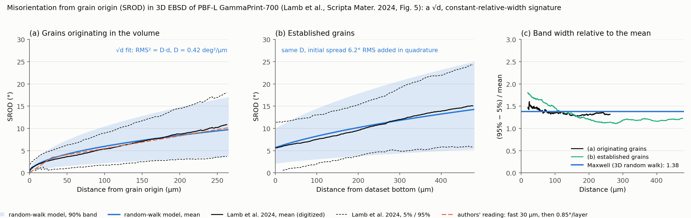
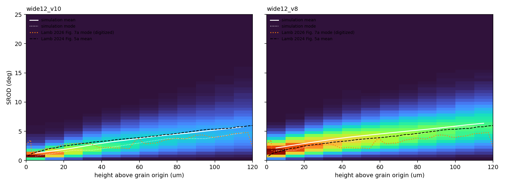
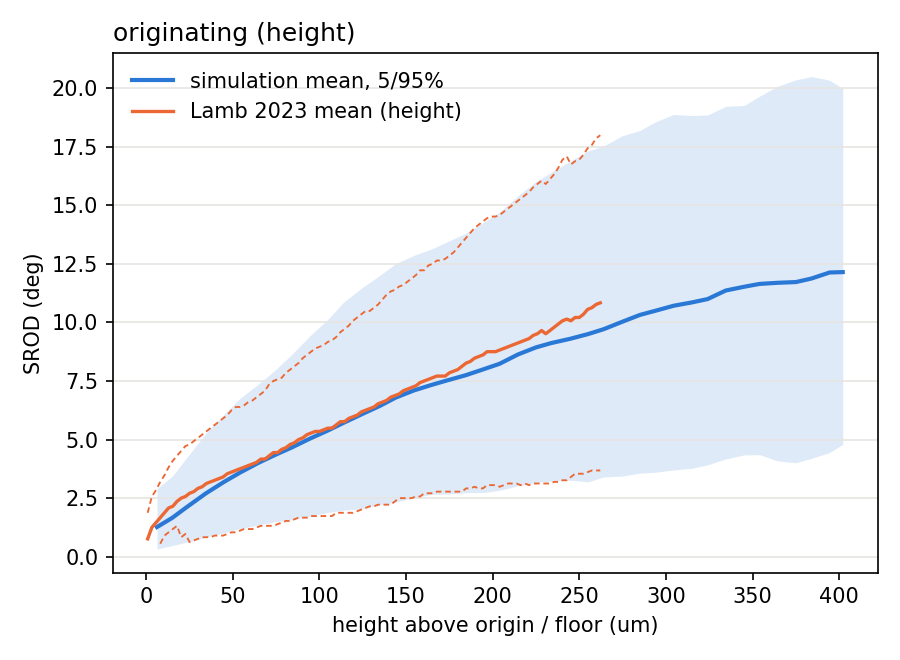
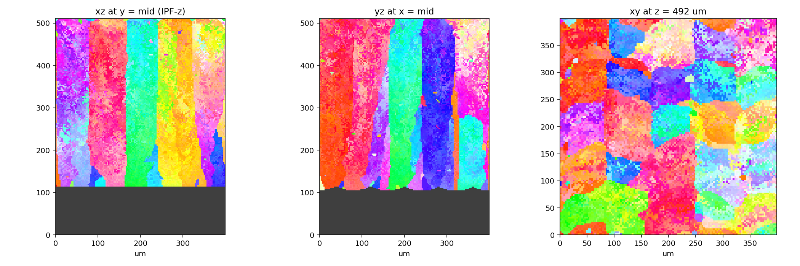
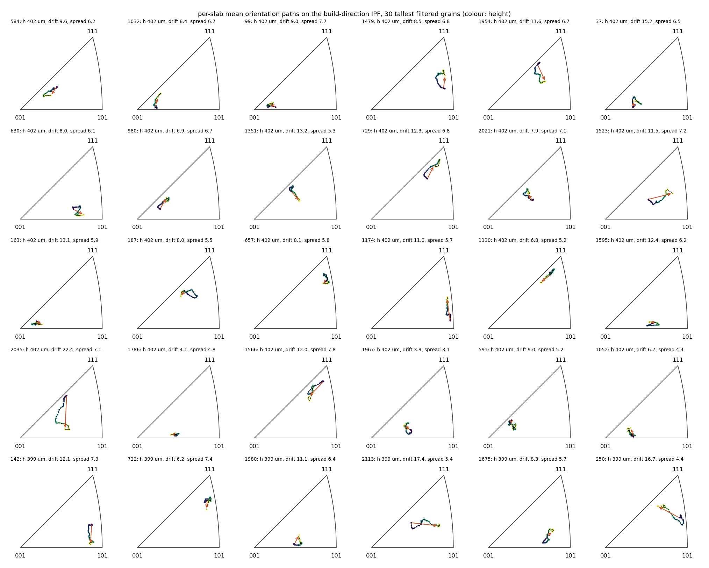
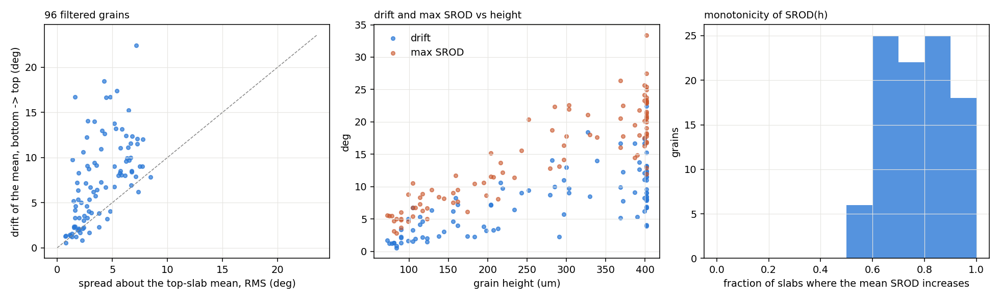
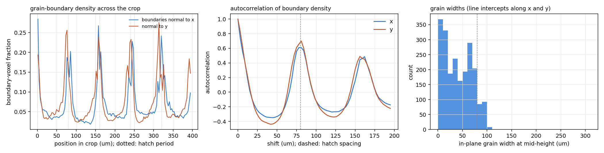

# Misorientation accumulation along columnar grains in GammaPrint-700 laser powder bed fusion: 3D-EBSD (Lamb et al.) versus SPPARKS

Revision 2b, 2026-09-10. **Reference version: `SROD_ANALYSIS_REPORT.tex` (PDF alongside); this file is generated from it with pandoc.** Figures are referenced by path under `docs/`.

# Summary

- Population SROD statistics in GP700 are those of a finite-variance
  rotation walk: mean $`\propto \sqrt{h}`$ within the resolution of the
  published curves, D ≈ 0.42 deg²/µm, Maxwell width. The same statistics
  arise from any process with independent increments per unit height, so
  they constrain the process, not its mechanism. Lamb’s example grains
  (2024 Fig. 4) rotate coherently along a path.

- Model, both SPPARKS additive apps: `misorientation_diffusion` $`D_v`$
  (per-voxel walk, inherited per hop) plus `misorientation_grain_walk`
  $`D_g`$ $`\rho`$ `path` (coherent per-grain walk, one Gaussian
  rotation-vector increment per unit of inheritance path length, shared
  by every voxel of the grain, correlated between levels with
  persistence $`\rho`$). Orientation is inherited from one parent voxel
  and never averaged. The model is an at-capture proxy for what Lamb
  attribute to post-solidification plasticity.

- Deck v10: $`D_v`$ 0.065 deg²/µm, $`D_g`$ 0.010 deg²/µm, $`\rho = 0.9`$
  (correlation length $`\approx \SI{30}{\micro\metre}`$ of path),
  calibrated on the 2024 originating curve (in-sample RMS 0.34 °).
  Held-out: established curve RMS / bias 0.28 / −0.11 ° and 0.47 /
  0.25 ° in two builds (v8, per-voxel only: 2.99 / 2.98 °); 2026 Fig. 7a
  mode 1.6 → 4.7 ° over 5–115 μm against v10’s 0.8 → 4.8 ° and v8’s 1.8
  → 5.8 °.

- Per grain (96 filtered grains): drift of the mean orientation median
  7.2 ° (v8 4.2 °), spread 3.4 ° (v8 6.1 °). Against Lamb: accumulation
  rate mean 0.84 / max 1.92 ° per 30 μm (2026: 1.7 / 5.8); grains with
  maximum SROD $`> \SI{25}{\degree}`$: 5 % (2024: “most”); per-layer
  mean at 300 μm median 10.8 °, max 18 ° (2024 example grains: 20–25 °).

- The constants are per unit of growth path (measured path factor 1.47
  at 3 μm, 1.68 at 1.5 μm) and first-order resolution independent: with
  $`\rho`$ and $`D_g`$ rescaled for the voxel size the deck reproduces
  Lamb at the experiment’s 1.5 μm voxel with a bias of 0.64 ° (per-voxel
  term alone: 0.41 °); the excess over the 3 μm result grows from 3 % at
  45 μm to 23 % at 282 μm, and rescaling the constants by the measured
  path-factor ratio (1.47/1.68) reduces the bias to 0.18 °.

- Limitations: hatch-locked grain structure (boundary autocorrelation
  0.6–0.7 at the 80 μm lag; a random per-layer hatch offset leaves the
  SROD results unchanged and the period only partly reduced); no
  surviving mid-build origins at nucleation
  6.5 × 10<sup>12</sup>–8.5 × 10<sup>13</sup>  m<sup>3</sup> (0–7 grains
  per run against Lamb’s $`> 500`$); a 2 ° re-segmentation gives 139
  filtered grains of ESD 29 μm (spin labels: 96, 148 μm) with the SROD
  curve within 0.6 °; seed scatter of the population score
  $`\approx`$<!-- -->0.05 ° RMS on the proxy and a second full build
  within 0.3 °; the $`\langle 001 \rangle`$ fraction within 15 ° of BD
  is 0.15–0.19 against a random 0.10 and has no measured target.

# Experimental methods (Lamb et al. 2024, 2026)

#### Material and process.

CoNi-base superalloy GammaPrint-700 (SB-CoNi-10), laser powder bed
fusion on an SLM Solutions SLM125 at 176 W and 1137 mm s<sup>−1</sup>,
80 μm spot (the papers give the spot size only; the deck reads it as
$`D4\sigma`$), 80 μm hatch, 30 μm layers, bidirectional scan with 90 °
interlayer rotation (the 2024 Fig. 2c sketch shows the direction
repeating every two layers and the scan directions at 45 ° to the block
edges), single 10 mm raster, 200 °C plate preheat. The hatch
registration between layers of the same direction is not stated. The
2026 paper supplies the thermophysical set used for its 3DThesis
simulations: $`k = \SI{22.5}{\watt\per\metre\per\kelvin}`$ (extrapolated
to 950 °C), $`\rho = \SI{8650}{\kilogram\per\cubic\metre}`$,
$`c_p = \SI{600}{\joule\per\kilogram\per\kelvin}`$ (IN718 at 1000 °C),
liquidus 1373 °C (1646 K), and an absorptivity of 0.9 selected to
reproduce measured pool dimensions; the solidus, 1319 °C (1592 K), is
from the 2024 paper.

#### 3D datasets.

2024: TriBeam tomography (femtosecond-laser serial sectioning with EBSD
on each slice), 1.5 μm voxels, 385 slices, a
$`1400 \times 412 \times 477`$ μm volume with over 9000 grains,
reconstructed in DREAM.3D and segmented at a 2 ° misorientation
threshold before any SROD calculation. 2026: a
$`120 \times 120 \times 169`$ μm volume at
$`0.1 \times 0.1 \times 1`$ μm resolving cells.

#### SROD.

For each grain the reference orientation sits near the origination
point, “the lowest location of a grain’s boundary along the build
direction”, offset one voxel layer (1.5 μm) upward so the reference is
not a boundary pixel; offsets up to 8 μm do not change the result.
*Originating* grains have their lowest point inside the volume;
*established* grains are cut by the dataset floor and referenced at the
centroid of their footprint on the lowest slice. Grains shorter than
60 μm (two layers) or under 40 μm equivalent spherical diameter (ESD)
are excluded, leaving over 500 originating and 100 established grains.
Each grain is sliced along the build direction; each slice gives a SROD
histogram fitted to a normal distribution, and the mean and the 90 %
interval of that fit are plotted against height above the origin
(Fig. 5a) or above the dataset floor (Fig. 5c). Fig. 4 follows four
grains (G1–G4) with IPF and SROD maps, the mean SROD per layer (“as
large as 20–25 °” after $`> \SI{300}{\micro\metre}`$), and every voxel
on the build-direction inverse pole figure with an arrow for the
rotation path from bottom to top; G4 splits into two orientation
clusters. The maximum SROD in any grain is 58.7 °; “most columnar
grains” contain over 25 °. The 2026 paper’s Fig. 7a is a heatmap of SROD
against distance from the grain start over 0–120 μm for the grains of
that volume (the paper does not say whether grains cut by the volume
floor are included), with quoted average and maximum accumulation rates
of 1.7 and 5.8 ° per 30 μm for bulk grains (2.5 and 7.2 ° for cells; the
paper does not state how the average was formed); it also reports that
cells switch $`\langle 100 \rangle`$ growth variants at fusion lines
rather than rotating continuously. Both papers attribute the
misorientation to plastic deformation: solidification shrinkage in the
mushy zone and thermomechanical cycling in the heat-affected zone of
subsequent layers (2024), and, in the 2026 paper, torsion and deflection
of cells by their neighbours during growth in the pool, with shear
strains of 0.2–3 % supported by synchrotron measurements; the last is an
at-solidification mechanism.

# Analysis of the experimental data

Fig. 5a and 5c of the 2024 paper were digitized from 300 dpi renders
(`docs/srod_random_walk.py`; curves in `docs/lamb2023_fig5a_srod.json`,
`docs/lamb2023_fig5c_srod.json`); no digitization uncertainty is claimed
beyond the line width, about 0.3 °. The curves were compared with a
rotation walk: independent small rotations of angle $`\theta`$ about
random axes give
``` math
\mathrm{RMS}^2 = n\,\theta^2 = D\,d,
```
a Maxwell distribution ($`\chi`$ with three degrees of freedom) with
mean $`= 0.921\,\mathrm{RMS}`$, and a 90 % interval of $`1.38 \times`$
the mean at every distance, which is also the value of
$`3.29\sigma/\text{mean}`$ for the normal fits Lamb plot. $`D`$ was
fitted by least squares of $`\mathrm{RMS}^2 = D h`$ to the digitized
mean over 0–265 μm with the 0.921 factor applied.

Findings (Fig. <a href="#fig:exp" data-reference-type="ref"
data-reference="fig:exp">1</a>): D = 0.42 deg²/µm fits the originating
mean, and the measured width ratio is 1.3–1.5 at every height for the
originating grains. The established grains are described by the same
$`D`$ only after adding an initial spread of 6.2 ° RMS in quadrature
(one fitted parameter, the orientation scatter already present at the
dataset floor); with it, their width ratio falls to 1.1–1.25 beyond
150 μm, as expected for a non-central distribution, and their mean runs
above the model past 300 μm. Over 30–260 μm the square-root curve and
Lamb’s own reading (a fast first 30 μm, then 0.85 ° per layer) lie
within the line width of each other; the two differ only below 30 μm,
where the digitization is least reliable. The population statistics
therefore establish independent finite-variance increments per unit
height and their magnitude, not the mechanism, and not whether the
increments belong to voxel lineages or to whole grains: each grain’s
coherent walk is one realisation, and the Maxwell width appears across
grains either way. Fig. 4 supplies the missing information for four
grains: the mean orientation moves along a path, so at least part of the
accumulation is coherent across a grain.

<figure id="fig:exp">

<figcaption>Lamb 2024 Fig. 5 digitized. (a) Mean SROD of originating
grains with <span
class="math inline">RMS<sup>2</sup> = <em>D</em><em>h</em></span>, D =
0.42 deg²/µm, and the authors’ two-regime reading. (b) Established
grains with the same <span class="math inline"><em>D</em></span> plus a
fitted 6.2 ° RMS initial spread. (c) Width ratio (90 % interval over
mean) against height for both classes; the Maxwell value is
1.38.</figcaption>
</figure>

# Simulation methods

#### Code.

SPPARKS, branch SURGE-kokkos, app `additive/texture/kk` (Kokkos/HIP on
an AMD gfx1151 APU), one MPI rank. The CPU app `additive/texture`
carries the same model and is the correctness reference; the temperature
field is deterministic and bit-identical between the two
(`examples/am_validation/`). Microstructure is not deterministic on the
GPU, so every build is one realisation of its seed.

#### Thermal source.

Moser Green’s-function solution with the GP700 constants
(`setup_temperature_source moser 176 0.9 22.5 4.335e-6 473 600 20e-6 20e-6 10e-6`:
power, absorptivity, conductivity, diffusivity, preheat, heat capacity,
and the Gaussian source widths $`\sigma_x, \sigma_y, \sigma_z`$ of 20,
20, 10 μm), evaluated on the device for every site each step. Scan lines
with `hatch 80e-6 N serpentine pause 8.8e-3`, the pause being the 10 mm
track length over the scan speed; the fast-forward predictor skips idle
gaps. Single-hatch check: pool $`147 \times 69`$ μm, thermal gradient
1 × 10<sup>7</sup> K m<sup>−1</sup>–2.9 × 10<sup>7</sup> K m<sup>−1</sup>
at the fusion boundary (paper: 3 × 10<sup>7</sup> K m<sup>−1</sup>).

#### Build.

Box-per-layer stitch continuation (`run_layers.sh`): each layer is a
separate SPPARKS run of a 180 μm window below the laser plane, started
from the preheat and from the previous layer’s microstructure. Domain
801 μm square (267 voxels at 3 μm), 10 hatches at $`40 + 80k`$ μm with
lines 100 μm past both edges, 12 layers of 30 μm, 90 ° rotation per
layer; layers of the same direction have their hatches at the same
positions (registered), which is the deck’s assumption where the papers
are silent. Substrate: 150 μm of 50 μm Voronoi grains with uniform
random orientations (`make_substrate.py`); five overlapping hatches
remelt 80 μm–100 μm, so the analysable solid begins at 105 μm (the
analysis floor is set at 100 μm). Timestep 4 μs, twice the front-advance
limit $`\Delta x / V(T_l - T_s)`$; 2 and 4 μs agreed on grain count and
size within the run-to-run scatter. Calibration used a 600 μm, 7-hatch,
8-layer proxy at 3 min of loop time per box.

#### Solidification kinetics.

Front velocity is a cubic polynomial in undercooling (the 304L
stainless-steel fit shipped with the additive app) scaled $`\times 3.5`$
(front at 25 K–35 K undercooling, about 0.56 m s<sup>−1</sup>, keeping
up with the 1.137 m s<sup>−1</sup> scan); nucleation density
1.5 × 10<sup>13</sup>  m<sup>3</sup>, critical undercooling
$`t_c = \SI{15}{\kelvin}`$ with a 2 K standard deviation across sites.
Parent selection per grain: candidate neighbours are grouped by grain,
each grain weighted by the mobility $`1 + c_2 \cos(c_3 \theta)`$ of its
mean orientation (the normalised sum of the candidate voxels’
quaternions after flipping each to the same hemisphere) against the
local thermal gradient ($`\theta`$ the angle between the nearest
$`\langle 100 \rangle`$ of that mean orientation and the gradient;
$`c_2 = 2.8`$, $`c_3 = 2.5`$, negative clamped to zero), then the parent
voxel is drawn uniformly inside the chosen grain. Weighting among the
voxels of one grain instead rotated grains toward
$`\langle 001 \rangle`$ with height and is not used.

#### Misorientation model.

Two terms, both applied at capture in the sample frame. The model is a
phenomenological proxy: it places at solidification the rotation that
Lamb attribute to shrinkage in the mushy zone and to cycling in the
heat-affected zone of later layers. It therefore cannot represent any
dependence of a voxel’s SROD on the number of layers deposited above it,
and a 12-layer build is compared here with material from the interior of
a 10 mm block.

- *Per-voxel walk*, `misorientation_diffusion` $`D_v`$ `30`: the
  captured voxel takes its parent’s orientation rotated by
  $`\theta = \sqrt{D_v\,\mathrm{hop}}`$ about a random axis (hop =
  lattice distance to the parent, so $`D_v`$ is per unit of growth
  path). A rotation past 30 ° would start a new grain (never reached).
  Independent lineages of one grain diverge, so this term supplies
  intragranular spread and no net drift.

- *Coherent grain walk*, `misorientation_grain_walk` $`D_g`$ $`\rho`$
  `path`: every voxel carries its inheritance path length $`s`$ in
  lattice units (per-site field d10: zero at melt and at nuclei, parent
  plus hop at capture, copied with the orientation on a smoothing flip,
  exchanged with ghosts and continued through the stitch). Between path
  levels $`k`$ and $`k+1`$ every voxel of grain $`g`$ receives the same
  rotation, a Gaussian rotation vector $`v_k`$ of RMS
  $`\sqrt{D_g \Delta x}`$ whose sequence in $`k`$ is Ornstein–Uhlenbeck,
  $`v_k = \rho\,v_{k-1} + \sqrt{1-\rho^2}\,v'_k`$, with $`v'_k`$ hashed
  from $`(g, k)`$ so the sequence is a pure function of grain and level,
  path independent and without stored state. The correlation length is
  $`\approx \Delta x/(1-\rho)`$ of path and the long-range accumulation
  is $`D_g (1+\rho)/(1-\rho)`$ per unit path; $`\rho`$ is defined per
  lattice level, so a change of $`\Delta x`$ requires
  $`\rho' = 1 - (1-\rho)\Delta x'/\Delta x`$ to keep the correlation
  length and a corresponding rescaling of $`D_g`$
  (Section <a href="#sec:res" data-reference-type="ref"
  data-reference="sec:res">6.8</a>). This term supplies the coherent
  drift. A device cache of the recurrence makes it cost nothing
  measurable.

#### Boundary smoothing.

One greedy steepest-descent pass per captured voxel
(`smooth_greedy_multiproposal on`, nrefine 1) the step after capture,
and `smooth_orientation copy`: a voxel that changes grain takes one
random neighbour’s orientation and path length from that grain. The
default `average` (sign-aligned mean of the new grain’s neighbours)
cancels the fresh rotations of a voxel-scale mixed front, retains only
0.3–0.45 of the input $`D`$ and widens the population band to 1.8; it is
not used.

# Simulation analysis methods

`gp700_analysis.py` on the spparks-micro-analysis tools: read the last
stitch frame; solid means `i2 == 3` (solidified; unremelted substrate,
`i2 == 1`, is excluded); crop to the central 400 μm laterally (300 μm on
the proxy), grains cut by the crop faces kept with their cropped volume;
label grains as connected components of the spin field, or optionally
re-segment at a disorientation threshold (`--segment-deg`); grain
volume, equivalent spherical diameter (ESD, from the cropped volume) and
extents; Lamb’s filters (height $`\geq \SI{60}{\micro\metre}`$, ESD
$`\geq \SI{40}{\micro\metre}`$); origin = the grain’s lowest solid
voxel, whose quaternion is the reference (exact in the simulation, so no
offset); grains crossing the analysis floor are established and
referenced at their floor-slice centroid. SROD is the symmetry-reduced
disorientation of every voxel from its grain’s reference, binned by
height above the origin or floor in 10 μm steps with mean, $`p_5`$,
$`p_{95}`$ and RMS per bin. Score: RMS of (simulated mean $`-`$ Lamb
Fig. 5a mean) over 25 μm–240 μm, its bias, the band ratio
$`(p_{95}-p_5)/\text{mean}`$ averaged over the same bins, the fraction
of solid within 15 ° of $`\langle 001 \rangle`$ parallel to the build
direction (random: 0.102 by Monte Carlo), and grain counts. ESD values
quoted for a build are volume-weighted medians over all grains of the
crop (the ESD of the grain holding the median voxel); the
number-weighted median ESD of the filtered grains is 75 μm in v10 and
72 μm in v8, and the filtered grains hold 96 % of the crop volume.
Calibration: Sobol designs (scipy `qmc`; 16 + 8 points over $`D_v`$
0.2–2.0, nucleation 1 × 10<sup>13</sup>–1 × 10<sup>14</sup>, $`t_c`$
3–25 K, $`c_2`$ 1–4, then 8 points over $`c_2`$ 2–8 and nucleation
5 × 10<sup>12</sup>–5 × 10<sup>13</sup>) on the proxy against the
Fig. 5a score fixed $`D_v`$ for the per-voxel model; for the two-term
model $`\rho`$ was set from a target correlation length of 30 μm of path
(the height of Lamb’s initial fast regime), $`D_g`$ from the requirement
that the coherent term supply most of the long-range accumulation with
the per-voxel term retained for intragranular spread
($`D_g (1+\rho)/(1-\rho) : D_v \approx 3`$), and the sum rescaled once
to the Fig. 5a level; the Fig. 5c established curve and the 2026 Fig. 7a
heatmap were not consulted.

`grain_paths.py` reproduces Lamb’s Fig. 4 per grain and extends it to
every filtered grain: IPF-Z and SROD maps on the $`xz`$ slice through
the grain, mean SROD per 10 μm slab, the per-slab mean orientation as a
path on the build-direction inverse pole figure, the drift of the mean
orientation from the bottom three slabs to the top three, the RMS spread
of the top slabs about their mean, the maximum SROD, the per-layer mean
at 300 μm, the accumulation rate (drift per 30 μm of height), the path
length per unit height from d10, and the fraction of slabs in which the
mean SROD rises. Both scripts use the same labelling, so the
filtered-grain counts agree except that `grain_paths.py` drops grains
with fewer than 20 voxels in their bottom or top slabs (97 vs 96 in v10,
88 vs 86 in v8). `hatch_periodicity.py` measures the boundary-voxel
density across the crop, its autocorrelation at the hatch lag, and
in-plane grain widths by line intercept; `origin_census.py` counts
filtered grains that originate more than 60 μm above the first remelt
floor.

# Results

## Calibration path

The Fig. 5a score is the calibration target, so the v8 and v10 rows are
in-sample fits (v10 is set in bold as the working deck, not as the
better-supported model), and their difference (0.49 vs 0.34 °) is within
the digitization line width; the population curve does not choose
between the two models. v2’s linear growth was selection drift among the
voxels of one grain. v5 to v7 retained only 0.3–0.45 of the input $`D`$
against height with a 1.8 band, both from the averaging smoothing rule;
copy-mode smoothing (v8) put the population curve, shape and band on
Lamb. v8’s grains, however, spread without drifting, whereas Lamb’s
grains move along a path; the coherent grain walk (v10) supplies the
drift. A memoryless coherent walk makes individual SROD($`h`$) curves
wander; correlating the rotation vector between levels ($`\rho`$) makes
them rise along a directed path, and with Gaussian increments the
population band stays at Lamb’s value in both the ballistic and the
diffusive regime.

## Held-out comparisons

<figure id="fig:heat">

<figcaption>Voxel-weighted SROD against height above the grain origin
over the first 120 μm for the filtered originating grains of v10 (left)
and v8 (right), with the digitized mode of Lamb 2026 Fig. 7a and the
2024 Fig. 5a mean.</figcaption>
</figure>

The established class is the discriminating test. The per-voxel model’s
floor-referenced grains start 3 ° too high because their lineages have
already diverged across the grain by the time they cross the floor,
whereas the coherent model, whose intragranular spread is small,
reproduces the curve to 0.28 ° in the first build and 0.47 ° (bias
0.25 °) in the second, with the Maxwell band. The result depends on
where the floor is placed, because the model’s intragranular spread
grows with path from the origin: floors at 200, 240 and 300 μm give
biases of $`-0.65`$, $`-0.11`$ and 0.44 °, so the agreement is at the
0.5 ° level rather than the 0.1 ° the best floor suggests. The 2026
heatmap is a weaker test. Its density-weighted mean (about 5 ° from the
grain start) carries no stated digitization uncertainty and is flat
because the volume contains grains that start at or below its floor, as
the established class does in 2024; only the mode is used here. Against
the mode, v10 runs 30–50 % low over the first 60 μm (0.8 vs 1.6 ° at
5 μm) and meets it by 115 μm, while v8 tracks it within 0.2 ° to 60 μm
and overshoots by 115 μm; the RMS of the modal residuals is 0.8 ° for
v10 and 0.6 ° for v8. The 2026 mode at 5 μm (1.6 °) is the sub-30 μm
information the 2024 curves lack; it sits above the pure $`D = 0.42`$
walk (1.2 °) and above v10, i.e. the experiment accumulates faster than
either over the first two voxel layers of the coarse dataset.

## v10 against Lamb Fig. 5a

The fitted $`D`$ against height exceeds the deck constants times the
measured path factor by 15 % (v10) and 28 % (v8): the walk’s own excess
over the height index (diagonal hops, and for the coherent term the
ballistic regime below the correlation length, where accumulation runs
faster than the long-range rate) adds to the geometric path factor.

<figure id="fig:v10srod">

<figcaption>v10, all-originating SROD against height above the origin
(central 400 μm crop, floor 100 μm): simulated mean with the 5/95 band
(blue) against Lamb 2024 mean and 90 % interval (orange).</figcaption>
</figure>

<figure id="fig:v10ipf">

<figcaption>v10 IPF-Z colouring: <span
class="math inline"><em>x</em><em>z</em></span> and <span
class="math inline"><em>y</em><em>z</em></span> sections through the
crop centre, and the <span
class="math inline"><em>x</em><em>y</em></span> section at 492 μm. Dark
grey is the unremelted substrate. The boundaries at 80 μm intervals
coincide with the hatch centrelines (Section <a href="#sec:hatch"
data-reference-type="ref"
data-reference="sec:hatch">6.5</a>).</figcaption>
</figure>

## Per-grain orientation paths

<figure id="fig:grid">

<figcaption>v10: per-slab mean orientation of the 30 tallest filtered
grains as paths on the build-direction inverse pole figure (colour:
height; orange arrow: bottom to top). All 30 span the full analysable
height and are substrate continuations.</figcaption>
</figure>

<figure id="fig:summary">

<figcaption>v10, all 96 filtered grains: drift against spread (dashed:
equal), drift and maximum SROD against grain height, and the
monotonicity of the per-grain SROD(<span
class="math inline"><em>h</em></span>).</figcaption>
</figure>

The coherent term changes the per-grain picture in the way Lamb’s Fig. 4
requires: the mean orientation of a v10 grain drifts more than it
spreads, the drift scales with height (about 2 ° at 100 μm, 8–15 ° at
400 μm), and the paths are directed; v8’s grains spread more than they
drift at every height. Against Lamb’s numbers, however, both models fall
short. The accumulation rate of the v10 grains (drift of the mean
orientation per 30 μm of height, averaged over grains) is half the 2026
average and its maximum is a third of theirs, if the paper’s average is
a comparable per-grain quantity; the per-layer means at 300 μm reach
18 ° at most against “as large as” 20–25 ° for Lamb’s four example
grains, which were chosen as illustrations and are not a population
statistic; and 5 % of the v10 grains exceed 25 ° anywhere, against
“most” in the experiment (a maximum-SROD statistic that in EBSD is
sensitive to boundary and misindexed voxels, so the experimental side is
an upper estimate). Lamb’s own figures are not mutually consistent (a
mean above 25 ° over 300 μm in the text against 11 ° at 260 μm in
Fig. 5a); the population curves are taken as the target and the
per-grain numbers as indicative. The population mean is matched, so the
experimental population must carry a much heavier tail, a minority of
grains rotating several times faster than the median, than a single
Gaussian $`D_g`$ produces; the 10–15 ° secondary band of the 2026
heatmap and the split grain G4 point the same way. The paths have no
preferred direction on the triangle, as the isotropic rotation vector
implies; the experimental direction is not reported. Monotonicity does
not separate the models (0.79 vs 0.78): about a fifth of the grains
reverse over 100 μm scales in both. The per-grain drift-to-spread ratio
confirms the construction ($`\sqrt{D_g(1+\rho)/(1-\rho)/D_v} = 1.7`$)
rather than an experimental value; Lamb’s within-slice widths, which
would fix it, are not published.

## Grain structure and the hatch pattern

The grain boundaries of both full builds fall at 80 μm intervals in
$`x`$ and in $`y`$: the boundary-density autocorrelation at the 80 μm
lag is 0.61 / 0.70 ($`x`$ / $`y`$) in v10 and 0.58 / 0.71 in v8, and
43–62 % of the spectral power of the boundary density sits at the hatch
period (`hatch_periodicity.py`,
Fig. <a href="#fig:hatch" data-reference-type="ref"
data-reference="fig:hatch">7</a>). In-plane grain widths by line
intercept have medians of 30, 39 and 51 μm at 200, 300 and 405 μm height
($`p_{90}`$ 72–84 μm). The cause is the deck’s registered hatch pattern:
layers $`n`$ and $`n+2`$ have identical scan lines, so the pool
centrelines, where the last liquid solidifies, recur at the same
positions and select the same columns, and the grains become
$`\sim 80 \times 80`$ μm columns spanning the build, which also
compresses the ESD distribution ($`p_{10}`$–$`p_{90}`$ 76–170 μm). Lamb
describe serrated, irregular boundaries. The papers do not state the
hatch registration of the SLM125 build. As a sensitivity test the driver
gained a per-layer hatch offset (`HATCH_OFFSET=random`: a seeded uniform
shift in $`[-40, 40)`$ μm along the hatch normal, so layers $`n`$ and
$`n+2`$ no longer register), and the v10 settings were run on the proxy
with it against a registered proxy of the same seed. The offset lowers
the boundary autocorrelation at the hatch lag from 0.46 / 0.45 to 0.34 /
0.48 ($`x`$ / $`y`$) and the spectral power at the period from 0.47 /
0.57 to 0.52 / 0.39; grain widths (median 27–36 vs 30–33 μm), ESD
($`p_{50}`$ 120 vs 123 μm), the SROD score (0.30 ° / −0.14 °, band 1.50)
and the per-grain drift and spread (5.3 / 3.6 ° vs 6.0 / 3.8 °) are
unchanged within the seed scatter, while the $`\langle 001 \rangle`$
fraction rises from 0.21–0.25 to 0.30 (one realisation). A normalised
autocorrelation of the height-integrated boundary density is insensitive
to phase, so it cannot separate registration from the pool spacing
itself, which imprints an 80 μm period on every layer; the unchanged
grain widths and ESD under the offset are the evidence that the column
selection is not registration-driven, and the SROD results do not depend
on it. Whether the experimental grains carry the same imprint cannot be
read from the published sections.

<figure id="fig:hatch">

<figcaption>v10: grain-boundary density across the crop with the hatch
period marked, its autocorrelation, and the in-plane grain-width
distribution at mid-height.</figcaption>
</figure>

## Grain definition

Re-segmenting the simulated volume at Lamb’s 2 ° disorientation
threshold (`--segment-deg 2`) changes the grain population. v10: 411 000
labels, 139 pass Lamb’s filters (spin labels: 96), ESD $`p_{50}`$ 29 μm,
two grains span 300 μm; the Fig. 5a score stays within 0.6 ° (bias
−0.45 °, band 1.49), and the per-grain drift / spread become 5.5 /
1.9 °. v8: 758 000 labels, 54 filtered grains of ESD $`p_{50}`$ 8 μm, no
grain taller than 165 μm, score 1.19 °. The per-voxel walk alone does
not survive a 2 ° segmentation as columnar grains; the coherent model
keeps its SROD curve but not its grain size, because the simulated
same-grain neighbour disorientation (median 2.4 ° in v10) sits at the
threshold. The simulated field carries voxel-scale orientation noise
that the EBSD does not (the 2.4 ° neighbour disorientation is a property
of independent-lineage inheritance at this $`D_v`$ and would be lower
only with a smaller per-voxel term), so the two segmentations are not
equivalent; the spin labelling is the one used elsewhere in this report.
The 2 ° segmentation does, however, change the grain-class picture of
the next section: on it, 55 of the 141 filtered v10 grains (13 % of the
filtered volume) originate more than 60 μm above the remelt floor,
because the coherent walk builds low-angle boundaries inside columnar
grains that a 2 ° threshold reads as new grains, as Lamb’s G4 does; v8
gives none.

## Grain origins

With the spin labelling, 3 of the 100 filtered v10 grains and 3 of the
94 filtered v8 grains originate more than 60 μm above the remelt floor
(0.5 % of the filtered volume): the columnar grains are epitaxial
continuations of substrate grains, so the simulated “originating” SROD
is an established-grain SROD referenced at the remelt floor. A census
over 26 existing proxy runs spanning nucleation densities of
6.5 × 10<sup>12</sup>–8.5 × 10<sup>13</sup>  m<sup>3</sup> and critical
undercoolings of 3–23 K finds 0–7 filtered grains per run originating
more than 60 μm above the floor (0–4 % of the filtered volume); Lamb’s
volume has over 500 such grains against 100 established. No region of
the tested parameter space produces surviving mid-build origins by
nucleation; nucleated grains are overgrown. Lamb’s originating grains
are products of a 2 ° segmentation, and on the same segmentation the
coherent model does produce mid-build origins (previous section), so the
like-for-like comparison is 55 : 86 (v10, 2 °) against Lamb’s
$`> 500 : 100`$; the model is short by a factor of about three in the
ratio, not absent. Analysing v8 on the full 801 μm domain, the central
400 μm, the central 200 μm, or without the never-remelted top layer
changes the SROD bias by under 0.2 ° and the band by under 0.03.

## Resolution

The per-voxel model (v8 deck) was run at Lamb’s 1.5 μm voxel on the
proxy with the same $`D_v`$ and geometry: SROD RMS / bias 0.49 ° /
0.41 ° against 0.44 ° / 0.03 ° at 3 μm, band 1.43 vs 1.41, same grain
size and texture, with the finer lattice accumulating 10–18 % more per
unit height because it resolves a slightly longer growth path. For the
coherent term, $`\rho`$ is per lattice level: keeping the 30 μm
correlation length at 1.5 μm takes $`\rho' = 0.95`$ and, to keep the
long-range accumulation, D_g′ = D_g (1+ρ)(1−ρ′)/((1−ρ)(1+ρ′)) = 0.0049
deg²/µm. With that rescaling the v10 deck at 1.5 μm on the proxy gives
Fig. 5a RMS / bias 0.74 ° / 0.64 ° (3 μm, three seeds: $`0.35 \pm 0.05`$
/ $`+0.05 \pm 0.11`$°), band 1.42 (1.53), per-grain drift / spread 7.8 /
4.4 ° (6.6 / 3.9 °), maximum SROD median 15.6 ° (13.7), accumulation
rate mean 1.00 ° per 30 μm (0.84), ESD $`p_{50}`$ 115 μm (123), and a
measured path length per unit height of 1.68 (1.47–1.49). The mean SROD
runs above the 3 μm value by an amount that grows with height: 3 % at
45 μm (3.4 vs 3.3 °), 10 % at 205 μm (9.6 vs 8.7) and 23 % at 282 μm
(12.4 vs 10.1). To test whether the longer resolved growth path (1.68 vs
1.47) is the cause, the run was repeated with $`D_v`$ and $`D_g`$
additionally scaled by $`1.47/1.68 = 0.875`$: the bias falls from 0.64 °
to 0.18 ° (RMS 0.30 °, band 1.49, drift / spread 7.1 / 4.4 °, path
factor 1.76), within two standard deviations of the 3 μm seed scatter,
and the excess over the 3 μm curve shrinks to $`-4`$ % at 45 μm, $`+7`$
% at 205 μm and $`+12`$ % at 282 μm. The path factor therefore accounts
for most of the resolution dependence, with a residual of order 10 % at
the top of the build that grows with height and is not explained. The
two-term model is resolution independent to first order once $`\rho`$,
$`D_g`$ and the per-path constants are rescaled with the voxel size and
the measured path factor.

## Seed scatter

<div id="tab:seeds">

|  | v8 settings (per-voxel only) | v10 settings (coherent + per-voxel) |
|:---|---:|---:|
| SROD RMS vs Fig. 5a | $`0.50 \pm 0.05`$° | $`0.35 \pm 0.05`$° |
| mean bias | $`+0.17 \pm 0.19`$° | $`+0.05 \pm 0.11`$° |
| band ratio | $`1.45 \pm 0.05`$ | $`1.53 \pm 0.07`$ |
| grains passing filters | $`52 \pm 2`$ | $`55 \pm 3`$ |
| $`\langle 001 \rangle`$ within 15 ° | $`0.23 \pm 0.02`$ | $`0.23 \pm 0.02`$ |
| per-grain drift, median | $`3.9 \pm 0.3`$° | $`6.6 \pm 0.5`$° |
| per-grain spread, median | $`6.7 \pm 0.7`$° | $`3.9 \pm 0.4`$° |
| per-grain maximum SROD, median | $`16.6 \pm 0.1`$° | $`13.7 \pm 0.3`$° |

Three seeds each of the v8 and v10 settings on the 600 μm proxy (8
layers, central 300 μm); mean $`\pm`$ standard deviation over seeds.

</div>

The seed-to-seed scatter of the population score is about 0.05 ° RMS and
0.1 ° to 0.2 ° in bias, so the in-sample difference between the two
models on the Fig. 5a curve (0.50 vs 0.35 °) is at the two-sigma level
and not decisive, as stated above; the band ratio, grain count and
texture do not separate the models at all. The per-grain drift and
spread separate them by more than five standard deviations in each
direction. A second full 12-layer v10 build with a different seed gives,
against the first: Fig. 5a RMS 0.21 ° / bias 0.00 ° (first: 0.34 /
−0.28 °), band 1.46 (1.50), 97 filtered grains (97), ESD $`p_{50}`$
156 μm (148), $`\langle 001 \rangle`$ 0.20 (0.15), established-class RMS
/ bias vs Fig. 5c 0.47 ° / 0.25 ° (0.28 / −0.11 °), per-grain drift /
spread medians 6.6 / 3.2 ° (7.2 / 3.4), per-layer mean at 300 μm median
9.9 ° (10.8), maximum SROD median 12.7 ° (15.0), path factor 1.49
(1.47). The second build also contains one grain that reaches 49 ° and
accumulates 5.4 ° per 30 μm, the only simulated grain so far in the
range of Lamb’s fastest; the per-grain extremes are seed-sensitive where
the medians are not.

## Texture

Neither paper quantifies a $`\langle 001 \rangle`$ fibre; the 2026 paper
discusses both $`\langle 001 \rangle`$- and
$`\langle 111 \rangle`$-oriented grains. A Sobol study over the mobility
contrast $`c_2`$ and nucleation density with $`D`$ fixed gave the
$`\langle 001 \rangle`$-within-15 ° fraction flat at 0.22 below
$`c_2 \approx 5`$ and rising by 0.0125 per unit $`c_2`$ above it, with
the SROD score unaffected; on the full build $`c_2 = 9`$ gave 0.22
against 0.19 at $`c_2 = 2.8`$. The coherent walk lowers the fraction
(v10: 0.15) because it carries grains out of the cone. Against a random
baseline of 0.102, the builds sit at 1.5–2.2$`\times`$ random.

# Findings and open issues

1.  Population SROD in GP700 has the statistics of a finite-variance
    rotation walk, D ≈ 0.42 deg²/µm against height with a Maxwell width;
    individual grains rotate along a path. The statistics do not
    identify the mechanism, and the published curves do not distinguish
    $`\sqrt{h}`$ from the authors’ two-regime reading above 30 μm; the
    2026 mode of 1.6 ° at 5 μm indicates faster accumulation below 30 μm
    than the single-$`D`$ walk gives.

2.  The two-term model reproduces the calibration curve and, without
    further tuning, the established-grain curve to within 0.5 °
    (floor-placement dependent), which the per-voxel model alone fails
    by 3 °; against the 2026 modal trajectory the two models are
    comparable. Per grain the model produces directed paths but
    accumulates at half Lamb’s average rate with far smaller extremes:
    the experiment has a heavy tail of fast-rotating grains that a
    single Gaussian $`D_g`$ does not give.

3.  Deck constants are per unit of growth path; the measured path length
    is 1.47 times the height. Both terms are resolution independent to
    first order once $`\rho`$ and $`D_g`$ are rescaled with
    $`\Delta x`$, with the measured path factor (1.47 at 3 μm, 1.68 at
    1.5 μm) carrying most of the residual resolution dependence.

4.  The simulated grain structure is locked to the deck’s registered
    hatch pattern; the experimental hatch registration is unknown.

5.  Grain classes: with spin labels no surviving grains originate
    mid-build at any tested nucleation density; with Lamb’s 2 °
    segmentation the coherent model gives an originating-to-established
    ratio of 55 : 86, against Lamb’s $`> 500 : 100`$, because its
    intragranular boundaries read as new grains.

6.  A 2 ° re-segmentation of the simulation changes its grain
    population; the two grain definitions are not equivalent, and the
    per-voxel term sets the intragranular neighbour disorientation that
    decides it.

7.  $`D_g : D_v`$ and $`\rho`$ are fixed here by construction and by the
    held-out curves only loosely; Lamb’s within-slice widths, per-grain
    rate distribution and path directions would fix them.

8.  Not yet tested: the undercooling dependence of $`D_v`$; a
    heavy-tailed or grain-dependent $`D_g`$.

# Reproduction

    . /home/tron/spack/share/spack/setup-env.sh && spack env activate spparks-dev
    # binary: build-verify/spparks (commit 6a47de77 or later); template = the v10 deck
    E=examples/gp700_moser; R=/home/tron/gp700_runs
    $E/run_layers.sh build-verify/spparks $R/wide12_v10 12 12345 267 10 4e-6 $R/substrate_800um_50um_d10.st
    /home/tron/miniconda3/envs/WORK/bin/python $E/gp700_analysis.py $R/wide12_v10/gp700.st \
        --out $R/wide12_v10/analysis_floor100 --floor-um 100 --crop 200 600 200 600
    /home/tron/miniconda3/envs/WORK/bin/python $E/grain_paths.py $R/wide12_v10/gp700.st \
        --out $R/wide12_v10/grain_paths --crop 200 600 200 600 --floor-um 100 --grid 30
    /home/tron/miniconda3/envs/WORK/bin/python $E/hatch_periodicity.py $R/wide12_v10/gp700.st --out $R/wide12_v10/hatch --crop 200 600 200 600

Reproducible artefacts: the digitized curves
`docs/lamb2023_fig5a_srod.json`, `docs/lamb2023_fig5c_srod.json` (the
2024 paper; file names carry the manuscript year) and
`docs/lamb2026_fig7a_srod.json`, the scripts above and
`docs/srod_random_walk.py`, the per-grain tables
`docs/gp700_results_v{8,10}/grain_stats.csv`, and the review-response
outputs in `docs/gp700_results_review/`. Key commits: fa8930f3
(per-voxel walk), ad23c1a5 (per-grain selection), 1a9712b3 (kk kernel
parity), da2fad29 (`smooth_orientation`), b6e4ba5f / 47546146 / 60b2d711
/ 6a47de77 (`misorientation_grain_walk`), f5d79cd3 (v10 deck), 71824e43
/ 21de639b (review analyses). The development log is
`docs/GP700_MOSER_SROD_DECK_PLAN.md`; the first review and the response
are `docs/SROD_REPORT_REVIEW.md` and `docs/SROD_REPORT_RESPONSE.md`.
This file is the reference version; `docs/SROD_ANALYSIS_REPORT.md` and
the published HTML page mirror it.

#### Sources.

J. Lamb, K. M. Pusch, A. T. Polonsky, S. A. J. Forsik, N. Zhou,
A. D. Dicus, R. Geurts, M. P. Echlin, T. M. Pollock, Scripta Materialia
239 (2024) 115770 (3D-EBSD and SROD of PBF-L GammaPrint-700; manuscript
dated 2023); J. Lamb et al., Metallurgical and Materials Transactions A
57A (2026) 2430 (cellular structure, intragranular SROD, 3DThesis
parameters).
